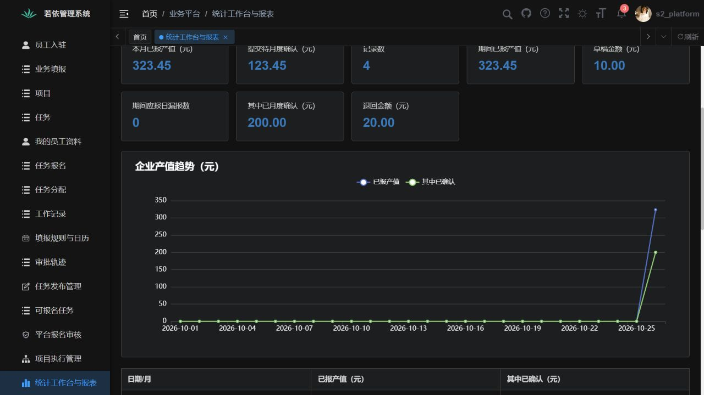
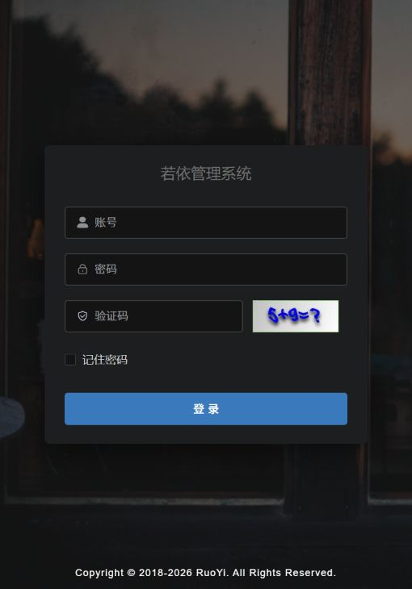

# 业务一体化平台

基于 RuoYi-Vue 的企业业务管理系统，采用 Spring Boot、Vue 3、Element Plus、MySQL、Redis 和 ECharts。前后端统一放在本仓库。

## 功能

企业与员工入驻审核、人员档案与门禁授权台账、工作日业务填报和漏报提醒、平台任务报名审核、企业内部任务、项目分配与员工领取、工作量审核和归档、统计图表及 Excel 报表。

已确认规则：企业任务仅内部使用；漏报只提醒；未报价不按零元计算；计划工作量×报价仅作估值，与每日填报产值分开。门禁尚未接真实设备，财务核对不包含支付与银行流水。

## 目录

| 路径 | 内容 |
| --- | --- |
| RuoYi-Vue-backend | Java 后端及各阶段迁移 |
| RuoYi-Vue3 | Vue 3 前端 |
| database | 最终完整结构与干净初始化数据 |
| deploy/stage10 | Nginx 配置与 Windows 部署工具 |
| docs/stage02～stage10 | 设计、使用及历史验收记录 |
| tests | 各阶段测试代码及历史结果 |

## 本地运行

环境：JDK17、Maven、Node.js（原开发环境为24）、MySQL8、Redis、Python3.10+（初始化工具）。先启动 MySQL 和 Redis。

1. 在后端目录编译：

```powershell
cd RuoYi-Vue-backend
mvn package -DskipTests
cd ..
```

2. 初始化到全新数据库。设置 MySQL 管理员密码环境变量 MYSQL_PWD，然后运行：

```powershell
python tools/init_database.py --database ry_platform_new --mysql-bin D:/mysql/bin/mysql.exe
```

工具拒绝覆盖已有数据库，生成随机管理员密码保存在被忽略的 initial-admin.local.txt。失败中断后不要向旧库重复导入，检查错误后改用新库名。database/init.sql 只供新安装，包含锁定管理员，不含演示企业、员工或任务；初始化工具负责启用管理员。

3. 参照 .env.example，在后端终端设置 APP_DB_URL、APP_DB_USER、APP_DB_PASSWORD、APP_TOKEN_SECRET 等环境变量。例如 PowerShell 用 `$env:APP_DB_USER="你的数据库账号"`。示例文件不会自动加载；令牌密钥须自行生成足够长的随机值。建立仅有业务库增删改查权限的数据库账号用于运行后端，勿使用root作为生产运行账号。

```powershell
cd RuoYi-Vue-backend
java -jar ruoyi-admin/target/ruoyi-admin.jar
```

4. 新开终端启动前端：

```powershell
cd RuoYi-Vue3
npm.cmd ci
npm.cmd run dev -- --port 5173
```

打开 http://localhost:5173 ，使用 admin 和本机生成的初始密码，填写验证码登录。原开发环境代理后端8080。纯净环境由管理员建立申请账号并分配普通员工角色，再申请企业或员工入驻。

## 构建与部署

前端 `npm.cmd run build:prod`，后端 `mvn package -DskipTests`。Nginx 将 /prod-api/ 代理到后端，参见 deploy/stage10/nginx.conf.template 与 docs/stage10/01_部署与运维.md。发布配置 application-release.yml 要求外部环境变量，关闭管理页面，并将后端绑定到本机。

Windows干净部署包可用 deploy/stage10/build_package.py 生成，先完成前后端构建，提供 MYSQL_PWD，并根据 deploy/stage10/nginx-source.json 从官网准备Nginx到downloads.local目录。工具默认MySQL路径为D:/mysql/bin，移植时按实际修改。

## 测试与状态

2026-10-26 原验收环境记录：384项回归、49项整链路、18项从零安装、15项部署检查，共466项通过；56张表及附件备份恢复校验一致。这些是历史验收结果，不是GitHub CI自动运行结果。

历史集成测试依赖本地演示种子与账号凭据，这些敏感本机文件未随仓库发布，不能在新克隆目录直接运行全部历史测试。自动化脚本运行前须配置 MYSQL_PWD、专用测试数据库与Redis库。干净部署包从零安装检查不依赖演示业务数据。详见 tests/README.md。

## 界面预览

以下为测试数据预览：





## 来源与许可证

基于 RuoYi 开源框架开发，保留其 MIT 许可证和版权声明，前后端原始许可证分别位于各自目录，根目录LICENSE保留原声明。Nginx等第三方软件遵循各自许可。

## 上传说明

本目录以全新Git历史整理，未包含原开发仓库历史、运行密码、备份、上传文件和二进制部署包。推送前复查 git status 和暂存文件；不要把原开发目录的旧.git复制回来。GitHub上传只公开源码，不会自动部署网站。
