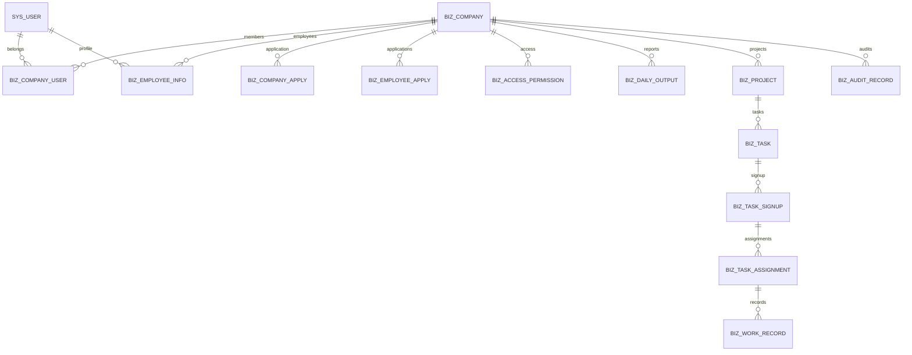

# 第二阶段数据库与权限设计

第一阶段于2026-10-23经用户确认完成。本阶段采用一账号一有效企业、多角色；企业人事可审核入职，企业内部任务无需平台审核，工作量默认不得超分配量。后续审批功能不在本阶段伪造实现。

## ER关系图

平台任务company_id为空；企业任务必须有company_id。审批business_type/business_id使用逻辑关联，其余核心链使用数据库外键与复合外键。企业申请未通过时company_id可为空。审批表仅允许业务服务插入；无公开任意写接口。

## 字段字典

各表通用：id主键；company_id企业（企业表本身用id）；status业务状态；version乐观锁；create_by/create_time/update_by/update_time审计；remark备注。所有金额与工作量使用DECIMAL(18,2)。

### biz_company 企业

|字段|类型与约束|含义|

|---|---|---|

|company_name|varchar(100) NOT NULL|企业名称|

|credit_code|char(18) NOT NULL UNIQUE|统一社会信用代码|

|contact_name|varchar(50)|联系人|

|contact_phone|varchar(30)|电话|

|address|varchar(255)|地址|

### biz_company_apply 企业申请

|字段|类型与约束|含义|

|---|---|---|

|applicant_id|bigint NOT NULL|申请账号|

|company_name|varchar(100) NOT NULL|申请企业名称|

|credit_code|char(18) NOT NULL|信用代码|

|contact_phone|varchar(30)|联系电话|

|qualification_ref|varchar(255)|资质附件引用|

|round_no|int NOT NULL DEFAULT 1|审批轮次|

### biz_employee_apply 员工申请

|字段|类型与约束|含义|

|---|---|---|

|user_id|bigint NOT NULL|申请账号|

|job_title|varchar(80)|申请岗位|

|round_no|int NOT NULL DEFAULT 1|审批轮次|

### biz_employee_info 员工档案

|字段|类型与约束|含义|

|---|---|---|

|user_id|bigint NOT NULL|关联若依账号|

|employee_no|varchar(40) NOT NULL|企业内工号|

|real_name|varchar(50) NOT NULL|姓名|

|job_title|varchar(80)|岗位|

|entry_date|date|入职日期|

|leave_date|date|离职日期|

### biz_access_permission 门禁授权

|字段|类型与约束|含义|

|---|---|---|

|user_id|bigint NOT NULL|账号|

|device_code|varchar(80) NOT NULL|设备编号|

|valid_from|datetime|有效期开始|

|valid_to|datetime|有效期结束|

|sync_status|varchar(20) NOT NULL DEFAULT 'PENDING'|同步状态PENDING/SUCCESS/FAILED|

|last_error|varchar(500)|最后同步错误|

### biz_daily_output 业务填报

|字段|类型与约束|含义|

|---|---|---|

|output_date|date NOT NULL|业务日期|

|output_value|decimal(18,2) NOT NULL|每日产值，不小于0|

|unit|varchar(20) NOT NULL DEFAULT '元'|计量单位|

### biz_project 项目

|字段|类型与约束|含义|

|---|---|---|

|project_code|varchar(50) NOT NULL|企业内项目编号|

|project_name|varchar(100) NOT NULL|项目名称|

|owner_user_id|bigint|负责人账号|

|start_date|date|开始日期|

|end_date|date|结束日期|

### biz_task 任务

|字段|类型与约束|含义|

|---|---|---|

|task_code|varchar(50) NOT NULL UNIQUE|全局任务编号|

|title|varchar(150) NOT NULL|任务标题|

|publisher_type|varchar(20) NOT NULL DEFAULT 'COMPANY'|PLATFORM/COMPANY|

|description|text|任务说明|

|project_id|bigint|所属项目|

|target_quantity|decimal(18,2) NOT NULL DEFAULT 0|目标工作量|

|unit|varchar(20) NOT NULL DEFAULT '件'|工作量单位|

|signup_deadline|datetime|报名截止时间|

|start_date|date|开始日期|

|end_date|date|结束日期|

### biz_task_signup 任务报名

|字段|类型与约束|含义|

|---|---|---|

|task_id|bigint NOT NULL|报名任务|

|contact_user_id|bigint NOT NULL|报名联系人|

|promised_quantity|decimal(18,2) NOT NULL|承诺数量|

|round_no|int NOT NULL DEFAULT 1|审批轮次|

### biz_task_assignment 任务分配

|字段|类型与约束|含义|

|---|---|---|

|task_id|bigint NOT NULL|任务|

|signup_id|bigint NOT NULL|审核通过的报名记录|

|user_id|bigint NOT NULL|员工账号|

|assigned_quantity|decimal(18,2) NOT NULL|分配工作量|

|due_date|date|截止日期|

### biz_work_record 工作记录

|字段|类型与约束|含义|

|---|---|---|

|assignment_id|bigint NOT NULL|分配记录|

|user_id|bigint NOT NULL|员工账号|

|work_date|date NOT NULL|工作日期|

|quantity|decimal(18,2) NOT NULL|上报工作量|

|evidence_ref|varchar(255)|工作凭证引用|

### biz_audit_record 审批轨迹

|字段|类型与约束|含义|

|---|---|---|

|business_type|varchar(40) NOT NULL|业务类型|

|business_id|bigint NOT NULL|业务ID，按business_type逻辑关联|

|round_no|int NOT NULL|审批轮次|

|applicant_id|bigint NOT NULL|申请人|

|reviewer_id|bigint NOT NULL|审核人|

|from_status|varchar(20) NOT NULL|原状态|

|to_status|varchar(20) NOT NULL|新状态|

|opinion|varchar(500) NOT NULL|审核意见|

|reviewed_at|datetime NOT NULL DEFAULT CURRENT_TIMESTAMP|审核时间|

### biz_company_user

id主键、company_id关联企业、user_id关联sys_user、status=ACTIVE/LEFT、create_time创建时间。生成列active_user只对ACTIVE记录取user_id，唯一索引限制一有效企业；同企业同用户唯一。

## 状态字典

- company: ACTIVE, DISABLED

- company_apply: DRAFT, PENDING, APPROVED, REJECTED, WITHDRAWN

- employee_apply: DRAFT, PENDING, APPROVED, REJECTED, WITHDRAWN

- employee_info: ACTIVE, LEFT

- access_permission: ACTIVE, REVOKED

- daily_output: DRAFT, SUBMITTED, CONFIRMED, RETURNED

- project: DRAFT, ACTIVE, COMPLETED, ARCHIVED, CANCELLED

- task: DRAFT, PUBLISHED, EXECUTING, PENDING_ACCEPTANCE, ARCHIVED, CANCELLED

- task_signup: PENDING, APPROVED, REJECTED, WITHDRAWN

- task_assignment: PENDING, EXECUTING, PENDING_CONFIRM, COMPLETED, CANCELLED

- work_record: DRAFT, SUBMITTED, CONFIRMED, RETURNED

- audit_record: RECORDED

状态迁移及审批在后续业务阶段实现；第二阶段仅提供业务填报DRAFT/RETURNED草稿维护，不能直接提交任意状态。门禁仅设计授权/同步记录，不对接设备。财务角色仅只读，无付款、结算写入功能。