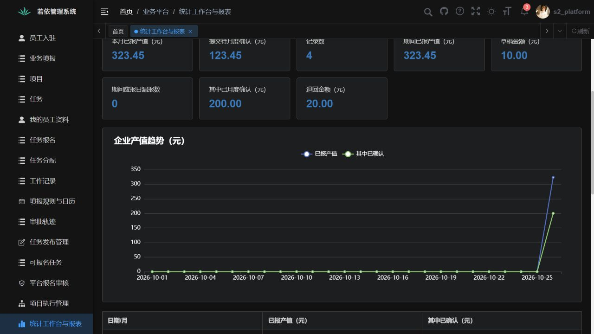
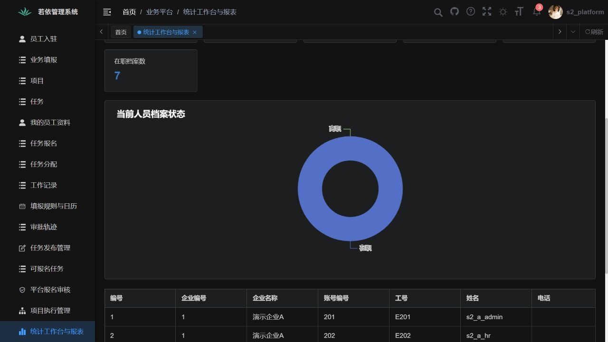

# 第九阶段测试验收

日期：2026-10-26。自动检查63项全部通过；后端打包及前端生产构建通过。独立测试数据库：`ry_platform_s9test_20261026104903`，不使用业务库制造演示数据。

验证内容包括：发布方报价及版本冲突、非负数及小数精度、项目快照冻结和只补空值、归档只读、角色与跨企业越权、产值与工作量一致性、自然月核对、七类Excel实际解析、公式文本安全及大金额精度保留。

浏览器实测：工作台折线图、人员饼图和项目进度柱图正常渲染，并修正深色主题文字对比度。截图为测试数据，不代表真实业务数据。测试界面曾在独立测试库临时关闭验证码，验收后恢复；业务库验证码配置未改。

## 逐项结果

| 检查 | 结果 |
| --- | --- |
| 任务发布方报价 | 通过 |
| 计划工作量按快照单价估值 | 通过 |
| 实际确认工作量独立展示 | 通过 |
| 进度仅计已确认量 | 通过 |
| 发布方更新报价 | 通过 |
| 已有项目快照不随任务报价重算 | 通过 |
| 报价旧版本拒绝 | 通过 |
| 负报价拒绝 | 通过 |
| 报价超过四位小数拒绝 | 通过 |
| 财务不能修改任务报价 | 通过 |
| 平台不能改企业发布方报价 | 通过 |
| 其他企业不能改报价 | 通过 |
| 未报价不按零估算 | 通过 |
| 已有缺价项目不被自动覆盖 | 通过 |
| 本企业主动补录缺失快照 | 通过 |
| 补录后金额可计算 | 通过 |
| 快照补录幂等且不覆盖 | 通过 |
| 其他企业不能补录快照 | 通过 |
| 归档项目禁止补录报价 | 通过 |
| 归档缺价报表保留未报价 | 通过 |
| 新旧项目分别保留报价快照 | 通过 |
| 任务单位变更后旧报价失效 | 通过 |
| 平台工作台企业数 | 通过 |
| 平台工作台员工去重人数 | 通过 |
| 平台工作台项目数 | 通过 |
| 平台本月产值仅计已报 | 通过 |
| 企业工作台范围正确 | 通过 |
| 日趋势与已报明细一致 | 通过 |
| 月趋势与已报明细一致 | 通过 |
| 草稿退回金额单列 | 通过 |
| 财务可查看本企业产值 | 通过 |
| 跨企业统计查询拒绝 | 通过 |
| 人事无财务统计权限 | 通过 |
| 人事仅获得人员报表 | 通过 |
| 人事员工档案范围 | 通过 |
| 财务无人员明细权限 | 通过 |
| 业务岗无财务核对报表权限 | 通过 |
| 普通员工无统计工作台 | 通过 |
| 企业无平台全量报表 | 通过 |
| 平台可查全量业务报表 | 通过 |
| 非法报表类型拒绝 | 通过 |
| 非法分组拒绝 | 通过 |
| 过大日期区间拒绝 | 通过 |
| 项目统计与执行明细一致 | 通过 |
| 财务按完整自然月核对 | 通过 |
| 无快照不伪造零差异 | 通过 |
| overview Excel可解析 | 通过 |
| outputs Excel可解析 | 通过 |
| projects Excel可解析 | 通过 |
| estimates Excel可解析 | 通过 |
| personnel Excel可解析 | 通过 |
| reconciliation Excel可解析 | 通过 |
| full Excel可解析 | 通过 |
| Excel中文工作表与冻结筛选 | 通过 |
| Excel公式样文本不执行 | 通过 |
| 跨企业Excel导出拒绝 | 通过 |
| 企业伪造全量导出拒绝 | 通过 |
| 人事财务Excel导出拒绝 | 通过 |
| 普通员工Excel导出拒绝 | 通过 |
| 平台全量Excel包含业务分表 | 通过 |
| 报表金额精度不经浮点丢失 | 通过 |
| Excel高精度金额按文本完整保留 | 通过 |
| 匿名报表查询拒绝 | 通过 |

详细自动结果：`tests/stage09/results.json`；Excel样本位于 `tests/stage09/artifacts/`。用户现场验收仍待完成。

