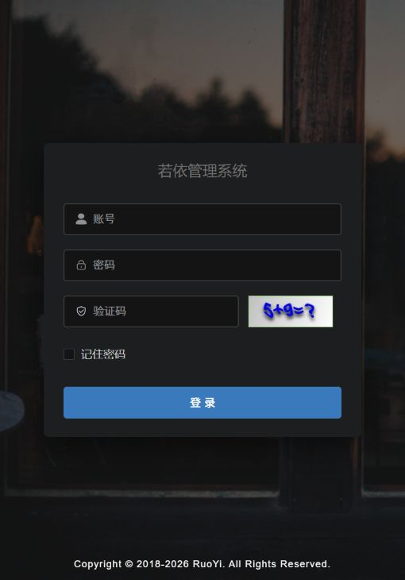

# 第十阶段测试与最终验收记录

日期：2026-10-26。开发自测与本机独立验收部署完成，用户现场最终验收待确认。未发布公网。

## 汇总

| 检查组 | 通过/总数 |
| --- | --- |
| 当前最终结构下第3至9阶段回归 | 384/384 |
| 通过Nginx的整链路验收 | 49/49 |
| 干净部署包从零安装 | 18/18 |
| 最终运行版本登录、权限与状态检查 | 15/15 |
| 合计 | 466/466 |

前端生产构建和后端打包均成功。最终后端已配置管理路径显式拒绝，随后重新运行全部384项业务回归，全部通过。业务规则与用户已确认口径一致。

重要操作：企业及员工双轮审核记录、工作量确认、任务分配、导出等操作记录已检查，权限变更与退出使旧会话失效。演示主流程产生企业3、项目1，项目已归档；计划估值250元、每日填报产值350元，分别显示，没有混算。

## 各阶段回归

| 阶段 | 通过 | 独立数据库 |
| --- | --- | --- |
| 03 | 31/31 | ry_platform_s3test_20261026165239_03 |
| 04 | 45/45 | ry_platform_s4test_20261026165239_04 |
| 05 | 53/53 | ry_platform_s5test_20261026165239_05 |
| 06 | 48/48 | ry_platform_s6test_20261026165239_06 |
| 07 | 64/64 | ry_platform_s7test_20261026165239_07 |
| 08 | 80/80 | ry_platform_s8test_20261026165239_08 |
| 09 | 63/63 | ry_platform_s9test_20261026165239_09 |

## 备份恢复实测

最终验收版本的备份恢复到全新数据库 `ry_restorecheck_20261026165513`，56张表行数和全部表内容校验值一致；SQL备份、附件压缩包及解压文件SHA256一致。未覆盖原业务库。独立应用账号仅有验收库SELECT/INSERT/UPDATE/DELETE权限，验证码开启。日志与凭据没有导入公开部署包。

## 基础并发检查与边界

同机小数据集，8并发32次统计查询全部成功，P50 31.28ms，P95 71.47ms；这属于功能并发冒烟，不代表公网生产容量。连接池和线程池收敛、gzip与首页缓存设置已应用，暂未进行大数据量容量压测或公网渗透测试。

企业A/B直接接口越权、角色按钮权限、重复提交和版本冲突、并发容量、计报日历与补填提醒、工作量进度、归档只读、Excel数值精度及公式安全均在自动检查中覆盖。本轮未发现高风险越权或重大统计错误；此结论限于已列出的测试场景。

从零安装过程中修复了初始随机密码长度、辅助类路径、Nginx目录与后台启动、脚本执行策略兼容问题，最终已实际验证随机管理员可登录、默认密码无效，干净库无演示企业/员工/任务。匿名和已登录管理员直接访问管理页面均被拒绝。

浏览器已验证最终生产构建登录页正常渲染、验证码保持开启。完整主流程通过相同Nginx代理执行，图表详细浏览器验收截图见第九阶段。本轮没有通过浏览器代填验证码。

## 逐项结果

### 整链路

| 检查 | 结果 |
| --- | --- |
| 生产构建首页可访问 | 通过 |
| 前端历史路由刷新可访问 | 通过 |
| Nginx关闭管理路径/druid/ | 通过 |
| Nginx关闭管理路径/swagger-ui/index.html | 通过 |
| Nginx关闭管理路径/v3/api-docs | 通过 |
| 验证码保持启用 | 通过 |
| 匿名业务接口拒绝 | 通过 |
| 企业执照通过代理上传 | 通过 |
| 企业保存入驻申请 | 通过 |
| 企业提交审核 | 通过 |
| 平台驳回企业申请 | 通过 |
| 企业修改重提 | 通过 |
| 企业重新提交 | 通过 |
| 平台通过企业申请 | 通过 |
| 企业管理员角色生效 | 通过 |
| 员工保存入驻申请 | 通过 |
| 员工提交 | 通过 |
| 企业驳回员工申请 | 通过 |
| 员工修改申请 | 通过 |
| 员工重提 | 通过 |
| 企业通过员工申请 | 通过 |
| 审核后旧员工会话失效 | 通过 |
| 平台新建任务 | 通过 |
| 平台发布任务 | 通过 |
| 任务发布方维护报价 | 通过 |
| 企业报名平台任务 | 通过 |
| 平台审核报名 | 通过 |
| 企业创建执行项目 | 通过 |
| 其他企业不可读取验收项目 | 通过 |
| 企业分配给入驻员工 | 通过 |
| 员工领取 | 通过 |
| 员工填写工作量 | 通过 |
| 员工提交工作量 | 通过 |
| 企业确认工作量 | 通过 |
| 员工完成分配任务 | 通过 |
| 企业填写每日业务产值 | 通过 |
| 企业提交业务产值 | 通过 |
| 确认工作量与项目进度一致 | 通过 |
| 预估金额与已报产值分开 | 通过 |
| Nginx代理Excel可解析 | 通过 |
| 普通员工不能导出企业报表 | 通过 |
| 项目complete | 通过 |
| 项目archive | 通过 |
| 归档后项目只读 | 通过 |
| 企业获得统计和业务菜单 | 通过 |
| 员工无管理员按钮权限 | 通过 |
| 8并发32次统计查询均成功 | 通过 |
| 员工退出登录 | 通过 |
| 退出后旧令牌失效 | 通过 |

### 从零安装

| 检查 | 结果 |
| --- | --- |
| 干净安装只有一个管理员 | 通过 |
| 干净安装无演示企业和员工 | 通过 |
| 干净安装无演示任务 | 通过 |
| 验证码开启且公开注册关闭 | 通过 |
| 干净部署使用非root账号 | 通过 |
| 部署包已去除开发数据库凭据 | 通过 |
| 部署包令牌密钥外置 | 通过 |
| 随机管理员密码可通过Nginx登录 | 通过 |
| 干净环境业务菜单可用 | 通过 |
| 干净环境统计企业数为零 | 通过 |
| 后端关闭管理页面/druid/index.html | 通过 |
| 管理员也不能绕过管理页面关闭/druid/index.html | 通过 |
| 后端关闭管理页面/v3/api-docs | 通过 |
| 管理员也不能绕过管理页面关闭/v3/api-docs | 通过 |
| 后端关闭管理页面/swagger-ui/index.html | 通过 |
| 管理员也不能绕过管理页面关闭/swagger-ui/index.html | 通过 |
| 默认弱密码不能登录 | 通过 |
| 停止脚本成功停止本站点 | 通过 |

### 最终版本

| 检查 | 结果 |
| --- | --- |
| s2_platform最终部署登录与菜单 | 通过 |
| s2_a_admin最终部署登录与菜单 | 通过 |
| s2_a_hr最终部署登录与菜单 | 通过 |
| s2_a_business最终部署登录与菜单 | 通过 |
| s2_a_finance最终部署登录与菜单 | 通过 |
| s2_a_employee最终部署登录与菜单 | 通过 |
| s2_b_admin最终部署登录与菜单 | 通过 |
| s2_b_employee最终部署登录与菜单 | 通过 |
| 升级后归档状态和确认工作量保留 | 通过 |
| 升级后报价快照金额保留 | 通过 |
| 最终后端关闭管理入口/druid/index.html | 通过 |
| 最终后端关闭管理入口/swagger-ui/index.html | 通过 |
| 最终后端关闭管理入口/v3/api-docs | 通过 |
| 前端安全响应头 | 通过 |
| 最终运行JAR与干净包一致 | 通过 |

## 复查文件

自动结果位于tests/stage10：regression-results.json、end-to-end-results.json、clean-install-results.json、deployment-smoke-results.json、restore-verification.json、deployment-checks.json；七类Excel解析样本位于excel-artifacts。部署包文件清单与SHA256位于包内manifest.json。

最终用户验收：分别登录平台、企业管理员和员工账号，复查业务链路、数据范围、图表与导出，确认后完成M3签收。公网域名证书接入、备份任务自动启用和异地存储仍需部署条件具备后执行。

